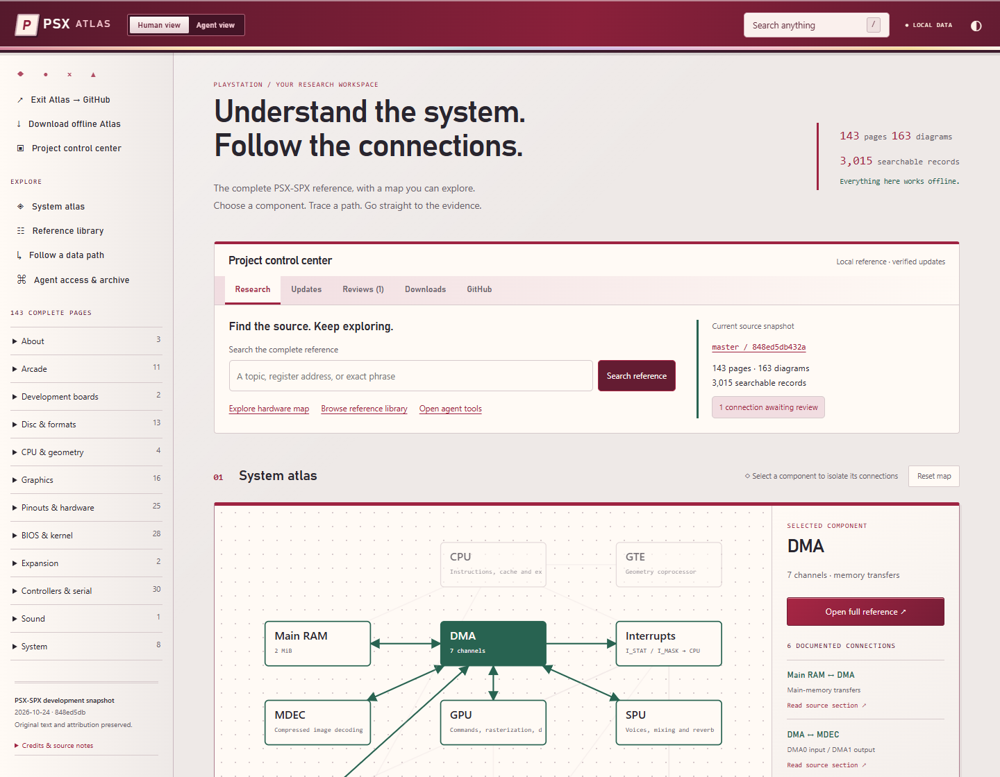

<p align="center">
  <a href="https://raiinman.github.io/PSX-Atlas/">
    
  </a>
</p>

<h1 align="center">PSX Atlas</h1>
<p align="center"><strong>Your interactive PlayStation research control center. Fully offline.</strong></p>
<p align="center">
  <a href="https://raiinman.github.io/PSX-Atlas/"><strong>▶ LAUNCH PSX ATLAS</strong></a> &nbsp; · &nbsp;
  <a href="https://github.com/raiinman/PSX-Atlas/releases/latest"><strong>↓ DOWNLOAD OFFLINE</strong></a> &nbsp; · &nbsp;
  <a href="https://github.com/raiinman/PSX-Atlas/tree/main"><strong>⌘ VIEW SOURCE ON GITHUB</strong></a>
</p>
<p align="center"><a href="https://raiinman.github.io/PSX-Atlas/agents.html">Agent access</a> · <a href="https://raiinman.github.io/PSX-Atlas/agent/START.md">Agent starting point</a> · <a href="https://github.com/raiinman/PSX-Atlas/actions/workflows/update.yml">Daily update checks</a> · <a href="https://github.com/raiinman/PSX-Atlas/issues/1">Evidence awaiting review</a></p>

The complete PSX-SPX development reference, presented as a source-linked hardware Atlas for people and AI agents. Full-text search, original articles and diagrams, exact-section retrieval, backlinks and open data formats share one archive. The red armor and pearl interface preserves the original green system map.

The Atlas homepage is an **interactive project dashboard**: search the reference, explore the original hardware map, inspect source updates and pending evidence, download verified archives and open the GitHub project. Status belongs to the packaged snapshot; no background network connection is required.

This is the repository's **README landing page**. The interactive app runs on **GitHub Pages**; click the banner or Launch button to use it. In the app, **Exit Atlas → GitHub** returns to the ordinary repository. GitHub's file browser stays available above this README.

[](https://raiinman.github.io/PSX-Atlas/)

*Actual working Atlas interface. The armor artwork in the promotional banners is decorative; the source-linked map above is the real navigation model.*

| For people | For AI agents | For offline use |
| --- | --- | --- |
| Search the complete reference, follow citations, enlarge diagrams and inspect register bit fields. | Start at agent/START.md; use topic cards, typed links, exact JSONL records, original Markdown or SQLite FTS5. | Download and extract the ZIP, then open index.html. Reading and browser search need no server, account or internet. |

[](https://raiinman.github.io/PSX-Atlas/agents.html)

Daily maintenance follows upstream **master**, builds and checks a pinned snapshot, then publishes a verified release and updates the live Atlas. Source branches, links, uncertainty and alternatives remain available. Changed evidence is flagged for review; it is not automatically approved. Previous releases and local backups remain available on failure.

**Current review:** the SPU update added LSAX write-latch and voice-start timing details. [See exactly what changed and why the SPU ↔ Sound RAM connection was flagged](evidence/SPU-UPDATE-848ed5db.md). The flag remains unapproved.

Source text and attribution: Martin “nocash” Korth and PSX-SPX contributors. Original credits and source rights statements remain in the archive. No new license is asserted over upstream material.

<details>
<summary><strong>Archive contents, agent commands, update schedules and technical documentation</strong></summary>

## Contents

- `offline/pages/`: all 143 published articles as static HTML, including all GPU tab contents and 163 inline SVG figures.
- `offline/markdown/`: all 144 original Markdown files and their committed source assets.
- `offline/extras/Motherboards/`: four additional board assets from the source repository.
- `offline/data/sections.jsonl`: 3,015 bounded retrieval records with titles, headings, exact anchors, local URLs, and source URLs. Duplicate nested-container text was removed and stray upstream text outside paragraphs is retained; all article prose is checked against capture.
- `offline/data/reference.sqlite`: pages, sections, links and SQLite FTS5 search.
- `offline/data/graph.json`: explicit page cross-references plus the added source-linked hardware model.
- `offline/llms.txt`: entry point for agents, including citation and uncertainty rules.
- `offline/agent/START.md`: compact agent instructions, also exposed through `AGENTS.md`, `llms.txt`, and HTML discovery metadata.
- `offline/agent/map.json`: 143-topic route map, approximately 37 KB. Read one topic card, then only the required record.
- `offline/agent/entities.json`: aliases and source-linked connections, including DMA transfer direction.
- `offline/agent/symbols.json`: compact eight-digit hexadecimal header-symbol index. Symbols can include constants as well as register addresses.
- `offline/agent/pages/`: small topic cards with headings, incoming/outgoing links, original Markdown paths and exact UTF-8 record offsets.
- `offline/agent/lookup.mjs`: dependency-free lookup and exact-section reader for Node.js 24+; included in the portable archive.
- `offline/data/capture-inventory.json`: source URL, capture timestamp, raw SHA-256 hashes, and capture failures.
- `offline/data/link-issues.json`: unresolved destinations already present upstream.
- `upstream/`: source repository checkout at `112d0914e7af6d29ad088cfc6b66973de9a3c4cd`.
- `archive/`: raw captured HTML, original search index, source stylesheet and downloaded media.
- `evidence/`: REA live-site evidence, browser checks and screenshots.

The archive boundary is the published `/dev/` reference and the source repository's documentation and board assets. Cited third-party websites are inventoried but their contents are not copied. External links open an offline citation dialog. The upstream PDF link returned HTTP 404; there was no PDF at that URL to capture. Use the Print button to print a page or save it as PDF.

The atlas is a conceptual navigation aid, not a hardware emulator. Bit-field inspection parses numeric ranges from the displayed source table and extracts bits; it does not model register side effects. Question marks, uncertainty notes, hardware variants, original credits and source rights statements remain intact. No new license is asserted over upstream text. MiniSearch's MIT license is included under `offline/licenses/`.

## Search and agents

Press `/` or select Search. Enter terms, an address such as `1F801810h`, or a quoted phrase. All terms are required; subsystem filters narrow results. Results jump to the exact source heading. Search is lexical; no language model or embeddings are included. Agents can read the original Markdown, retrieve JSONL records or query the database.

For fast agent orientation, start at `offline/agent/START.md`. Avoid crawling the 143 HTML pages or loading the entire corpus. Without a command runtime, use the small topic map, entity and symbol indexes, then a single topic card. With Node.js 24+ available, run from anywhere using the lookup script's absolute path:

```powershell
node offline/agent/lookup.mjs 'where does DMA3 go'
node offline/agent/lookup.mjs '0x1F801810'
node offline/agent/lookup.mjs 'texture cache'
node offline/agent/lookup.mjs --page 'ps1--system--dmachannels'
```

Use `--section ID` from a result for one exact source record. Agent lookups handle `0x`/`h` address forms and cached/uncached CPU address mirrors when resolving physical address symbols. The original lexical SQLite search remains available below.

With Node.js 24 or newer available:

```powershell
node scripts/query.mjs 'DMA2' 10
```

Or use SQLite with FTS5:

```sql
SELECT sections.heading, sections.local_url, sections.source_url,
       snippet(search, 3, '[', ']', '…', 24)
FROM search JOIN sections ON sections.id = search.id
WHERE search MATCH '"DMA2"'
ORDER BY rank LIMIT 10;
```

## Daily updates and installation

GitHub Actions checks PSX-SPX **master** daily at **14:23 UTC (08:23 MDT / 07:23 MST)** and when Atlas code changes. [Workflow](https://github.com/raiinman/PSX-Atlas/actions/workflows/update.yml) also supports manual dispatch. Download the latest verified ZIP from [Releases](https://github.com/raiinman/PSX-Atlas/releases/latest), extract it and open index.html. Source content and the Atlas UI remain separate.

Each update pins one upstream commit, fetches all branch/tag identities, renders the upstream documentation locally, regenerates every explicit link and heading, and checks corpus preservation, exact agent record offsets, local resources, offline browser interactions and accessibility. It builds in staging with read-only repository permissions. A separate publisher verifies file hashes, uploads all assets to a draft, then publishes it as latest. Previous releases remain available. Failures produce a maintenance issue and leave the last working release available.

Changed/added/removed source files, pages, headings and links are recorded in data/update-review.json. Manual hardware connections whose source document changed receive review badges and an open review issue. Original claims, uncertainty and alternatives are retained. Review flags persist until a person records the reviewed source hash under the exact edge ID in state/accepted-evidence.json; closing an issue alone does not accept evidence. No fixed DMA2 trace or semantic rewrite is generated.

This computer's daily installer checks the verified release at **15:07 UTC (09:07 MDT / 08:07 MST)**. It verifies the ZIP and every archived file before switching folders and retains the previous offline folder under _backups/. It does not need an AI model. Reading/searching remains fully offline; only maintenance uses the network. A sleeping/offline computer catches up when the scheduled task can run; this least-privilege task runs while you are signed in. Register it again after moving the checkout using `pwsh -File scripts/register-update-task.ps1`.

Manual installation of the latest release:

```powershell
npm ci --ignore-scripts
npm run install:update
```

To build a new source snapshot yourself, install Node.js 24+ and Python 3.12+, install requirements-upstream.txt, and set ATLAS_PYTHON to that Python executable. Then:

```powershell
npm ci --ignore-scripts
npx playwright install chromium
npm run test:updater
npm run update -- --stage-only
```

The updater reports its candidate path in _updates/last-attempt.json. Omitting --stage-only promotes a verified local build and retains the previous folder. Existing capture is a historical live-site acquisition command; automatic updates use a pinned local render to avoid mixing revisions. The optional upstream PDF plugin is excluded from this HTML build; all articles, inline diagrams and source assets remain included.

DOX is installed from [raiinman/dox](https://github.com/raiinman/dox) at b88194c34ace1a2a3dc01831d36b8a65986a41f5. Its framework and license are preserved in .dox/ and the repository has scoped AGENTS.md contracts.

For an optional loopback-only preview, `npm start` serves the already-built folder at `http://127.0.0.1:4173`. This is not needed for offline use.

DSL-Helper's frontend engineering, performance optimization and frontend design workflows were read at live revision `594499cb9a842822580d847d85abdf832814c27c` with maintenance overlay `dsi-0.1.13`. REA was used to observe the live site's browser network dependencies. Normal extraction/build tools preserve the full corpus; the REA observation alone is not a whole-site crawl.

The dual-view benchmarks reduced the initial reference-data payload from 15.6 MB to 43 KB. Across three fresh offline Chrome contexts on this host, median cold first-search time changed from 1,782 ms to 448 ms. Five agent query samples took 87–98 ms including Node startup. These are local synthetic measurements; see `evidence/performance-after.json` for the samples and conditions. `npm run benchmark` enforces a 1.5-second median cold-search budget and a one-second agent-process budget on the test host. All reading pages and machine text are validated against the captured source, and every retrieval byte range is checked.

After building and verifying, `npm run package` refreshes the portable ZIP and its SHA-256 inventory using Node.js.


</details>
